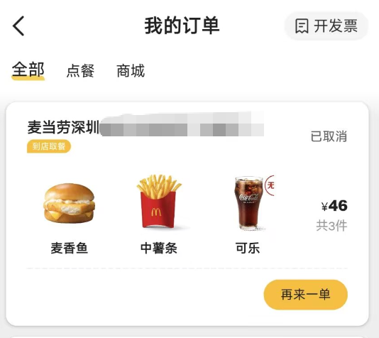

# 🍔 mcd-smart-order —— 麦当劳智能点餐 Skill

基于**麦当劳中国官方 MCP（mcd-mcp）**构建的智能点餐 Skill。把「我想吃点什么」这件小事，
做成一套**有约束求解能力、有安全兜底、可回归测试**的完整方案。

> 本项目为「麦当劳程序员节创意开发大赛」参赛作品，非麦当劳官方产品。
> 价格、营养与供应状态以麦当劳官方渠道实时结果为准。

---

## ✨ 四大能力

| # | 能力 | 说明 |
|:---:|:---|:---|
| 1 | **单人点餐** | 引导完成选品 → 规格（套餐 rounds/choices）→ 数量 → 算价 → 下单确认 |
| 2 | **到店取餐** | 门店查询、营业时间校验、预约时段校验（含跨零点）、自提方式（堂食/取餐柜）选择 |
| 3 | **预算＋偏好点餐编译器** | 把预算上限、口味偏好、忌口、过敏原、热量上限编译成**可执行查询条件**，求解满足全部约束的套餐组合；无解时给出最接近的替代方案并说明原因 |
| 4 | **能量营养搭配助手** | 按目标热量 + 蛋白/碳水/脂肪供能比，输出搭配建议与营养估算 |

---

## 🎯 目标用户

- **想省心的普通顾客**：一句话说清预算和忌口，直接拿到可下单方案
- **有饮食限制的人群**：过敏原、素食、忌口 —— 硬约束，绝不妥协
- **健身 / 控卡人群**：按目标热量与三大营养素配比搭配
- **开发者**：想要一个可复用、可测试的 MCP 点餐求解器参考实现

---

## 🚀 在 WorkBuddy 中使用（推荐）

这是本项目的**主要使用方式**——不用装依赖、不用跑脚本，配置好就能直接对话。

### 1. 申请 MCP Token

访问 <https://open.mcd.cn/mcp> → 登录 → 右上角「控制台」→「激活」，拿到 Token。

### 2. 配置 mcd-mcp 连接器

WorkBuddy 左侧栏「**专家 · 技能 · 连接器**」→「连接器」→ 右上角「自定义连接器」→「配置 MCP」，
把 [`mcp-config.example.json`](./mcp-config.example.json) 的内容粘进去，
将 `${MCD_MCP_TOKEN}` 替换成上一步拿到的真实 Token，保存后启用 `mcd-mcp`。

### 3. 安装 Skill

```bash
git clone --depth 1 https://github.com/RSS1102/mcd-smart-order.git \
  ~/.workbuddy/skills/mcd-smart-order
```

装好后的最小结构：

```
~/.workbuddy/skills/mcd-smart-order/
└── SKILL.md          # 必需：Skill 描述与工作流规则
```

> 💡 **只拷一个 `SKILL.md` 过去也够用。** Skill 的规则全在这份文件里，Agent 会按它
> 直接调 MCP 工具完成任务，**不需要跑本项目任何代码**。
> `src/` 是可选的参考实现，用于精确的组合求解与回归验证（见下一节）。

### 4. 开始对话

不用记命令，直接说需求：

> **你**：我在深圳科技园，想吃汉堡薯条可乐，在减肥，800 大卡以内
>
> **助手**：列出附近门店 → 你挑一家 → 给出 2-3 个满足全部约束的方案（含热量与价格）
> 　　　　→ 拉套餐规格让你确认 → 出订单确认单 → 你说「确认下单」
> 　　　　→ 创建订单 → 引导你去「麦当劳 APP → 订单 → 立即支付」

`SKILL.md` 的 `description` 里写了触发场景，Agent 会自动匹配，例如：

- 「我想吃麦当劳」「帮我点一份」
- 「预算 30 元吃什么」「600 大卡怎么搭配」
- 「我牛奶过敏能吃什么」「附近哪家店能自提」

> 地址和取餐时间**不是脚本入参**，是 Agent 在对话里问出来、你选出来的。

---

## 💻 命令行安装与使用

想跑代码、做回归验证、或把能力集成到自己的系统时走这条。

### 前置条件

1. 申请 MCP Token（同上一节第 1 步）
2. Node.js ≥ 20.10（推荐 22 LTS）

### 安装

```bash
git clone https://github.com/RSS1102/mcd-smart-order.git
cd mcd-smart-order
npm install
```

### 配置 Token

```bash
export MCD_MCP_TOKEN="<你的 MCP Token>"
```

**不要把真实 Token 写进仓库** —— `mcp-config.example.json` 里只有 `${MCD_MCP_TOKEN}` 占位符。

### 构建与测试

```bash
npm run typecheck     # 类型检查（strict）
npm run test          # 143 项单元测试，基于真实门店快照，离线可跑
npm run build         # 编译到 dist/
```

### CLI 命令

下面这些是我**直连真实 MCP 做回归验证**用的。`--city` / `--keyword` / `--reserve`
只是为了让脚本无人值守跑通而写死的示例值，真实使用时这些值来自对话：

```bash
node dist/src/cli.js menu      --city 深圳市 --keyword 科技园
node dist/src/cli.js compile   --city 深圳市 --keyword 科技园 \
      --text "预算35元以内，来个汉堡、薯条和可乐，不要吃辣"
node dist/src/cli.js nutrition --city 深圳市 --keyword 科技园 --kcal 650 --preset highProtein
node dist/src/cli.js pickup    --city 深圳市 --keyword 科技园 --reserve "2026-10-09 18:00"
node dist/src/cli.js delivery                # 外送：查地址 → 查可配送门店
node dist/src/cli.js order --code 515837     # 下单（默认 dry-run，只构造参数不发送）
```

> 小技巧：`query-nearby-stores` 传 `searchType=1` 可查**收藏餐厅**，连地址都不用报。

## 💡 使用示例

### 单人点餐

> **用户**：预算 35 块以内，来个汉堡、薯条和可乐，不要吃辣。

```
✅ 找到 3 个满足全部约束的组合：

方案 1（得分 72）
  - 双层深海鳕鱼堡三件套 ×1  ¥35.0  485 kcal
  合计 ¥35.0（原价 ¥47.5，省 ¥12.5）
  营养估算：485 kcal ｜ 蛋白 28g / 碳水 46g / 脂肪 21g ｜ 钠 917mg
  理由：预算利用率 100%；较原价省 ¥12.5；套餐已含主食+小食+饮料，无需凑单
```

### 下单与支付

选品确认后由 `create-order` 创建订单，**支付在麦当劳 APP 内完成**（Agent 不代付）：

```
选品 → calculate-price → 订单确认单 → create-order → 麦当劳 APP 支付 → query-order 核实
```

在麦当劳 APP「我的订单」里看到的结果（实测）：



订单创建后会给出 **15 分钟支付窗口**，未支付则自动取消（上图即为验证单，
超时后状态变为「已取消」，不产生任何扣款）。

> ⚠️ **`payH5Url` 是「扫码引导页」，不是支付页。**
> 打开后它还会再显示一个二维码让麦当劳 APP 扫 —— 那是为「电脑上打开、手机扫」
> 设计的。手机端如果扫这个码，会看到「又一个二维码」，形成套娃。
> 正确做法：**打开麦当劳 APP → 订单 → 找到本单 → 立即支付**。

### 无解时的替代方案

> **用户**：预算 10 元以内想吃汉堡薯条可乐，热量不超过 300 大卡，我牛奶过敏。

```
❌ 没有满足全部约束的组合。
未满足的约束：
  - 总价 ¥13.9 超出预算 ¥10

🔁 最接近的替代方案（放宽：热量上限 +10%、预算上限 +10%、件数上限 +1、…）
原因：总价 ¥72.5 超出预算 ¥10；热量 707 kcal 超出上限 300 kcal
仍然严格保留：过敏原「牛奶」
```

> ⚠️ **过敏原约束永不参与松弛** —— 这是本项目的设计红线。

### 营养搭配

> **用户**：我今天练腿，目标 650 大卡，要高蛋白配比。

```
目标 650 kcal，配比 highProtein = {蛋白 35%, 碳水 40%, 脂肪 25%}

方案 1：麦乐鸡 + 薄皮焦香V翅 + 板烧鸡腿堡
  合计 594 kcal（达成率 91%）｜蛋白 32g / 碳水 55g / 脂肪 25g
  实际供能比 蛋白 22% / 碳水 38% / 脂肪 38%
  ⚠️ 部分餐品采用名称近似匹配，数值为估算值
```

更多示例见 [`examples/`](./examples)。

---

## ⚠️ 异常处理

四种常见情况，用户会直接感知到：

| 场景 | 遇到时怎么办 |
|:---|:---|
| **售罄 / 不可售** | 自动换一个等价餐品，或提示核对就餐方式 |
| **超出预算** | 给出最接近的替代方案，并说明放宽了哪一项、保留了哪一项 |
| **门店不支持** | 换一家门店，或改用其它就餐方式 |
| **参数缺失** | 一次只问一个关键槽位，同时给出候选 |

> 完整的技术映射（错误码 `401` / `429` / `400` / `60006`、营业时间、预约时段非法、
> 地址无可配送门店等）见 [`SKILL.md`](./SKILL.md) §6。

---

## 📦 项目结构

```
mcd-smart-order/
├── SKILL.md                       # Skill 描述与配置（frontmatter + 工作流规则）
├── README.md                      # 本文件
├── CONTEST_DECLARATION.md         # 参赛声明（文件名与内容均不可改动）
├── MCP_INTEGRATION.md             # MCP Server / Tool / 调用流程 / 业务价值
├── mcp-config.example.json        # 脱敏 MCP 配置（仅环境变量占位符）
├── LICENSE                        # MIT 许可证
├── workbuddy.md                   # WorkBuddy 开发上下文
├── package.json / tsconfig.json
├── src/
│   ├── types.ts                   # MCP 数据模型（字段全部来自真实返回）
│   ├── mcp-client.ts              # Streamable HTTP 客户端 + 通道参数校验 + 信封解析
│   ├── errors.ts                  # 错误分类（401/429/400/60006/售罄/时段…）
│   ├── constraints.ts             # 过敏原·忌口·口味知识库、槽位提取、硬过滤
│   ├── compiler.ts                # ★ 预算＋偏好编译器（查询计划/搜索/松弛阶梯）
│   ├── nutrition.ts               # 营养表解析、名称匹配、配比求解、套餐子项加总
│   ├── pickup.ts                  # 门店选择、营业/预约时段校验、自提流程
│   ├── order.ts                   # ★ 下单与支付：确认单/复核/幂等/二维码/支付核实
│   ├── cli.ts                     # CLI：menu / compile / nutrition / pickup / delivery / order
│   └── index.ts                   # 公共入口
├── tests/                         # 143 项单元测试（基于真实门店与菜单快照）
│   ├── compiler.test.ts  nutrition.test.ts  pickup.test.ts
│   ├── order.test.ts     payment.test.ts    helpers.ts
├── fixtures/                      # 真实数据快照（深圳科技园门店，116 个餐品 + 160 条营养）
│   ├── meals.sample.json  meal-detail.sample.json  nutrition.sample.txt
├── docs/
│   ├── VALIDATION_REPORT.md       # 本地验证报告
│   └── assets/order-in-app.png    # 下单结果截图（麦当劳 APP 我的订单）
└── examples/                      # 示例对话（含真实 MCP 返回）
    ├── 01-single-order.md  02-pickup.md
    ├── 03-budget-compiler.md  04-nutrition.md
```

---

## 📄 许可与声明

- **代码许可**：MIT，见 [`LICENSE`](./LICENSE)
- **参赛声明**（原创性、合规性、信息安全、使用提示）：见 [`CONTEST_DECLARATION.md`](./CONTEST_DECLARATION.md)
- **MCP 集成说明**：见 [`MCP_INTEGRATION.md`](./MCP_INTEGRATION.md)

> 本项目为参赛作品，非麦当劳官方产品。项目输出仅供参考，不构成医疗、营养或其他专业建议；
> 餐品价格、营养成分及供应状态以麦当劳官方渠道的实时结果为准。
